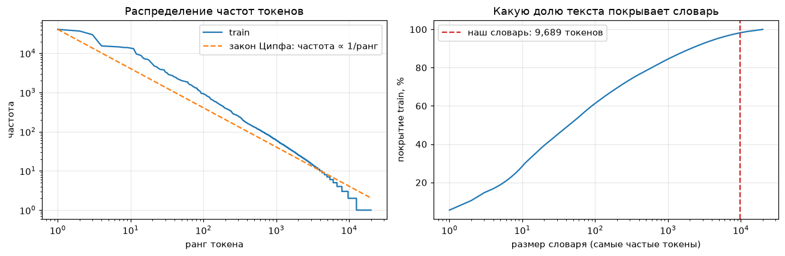
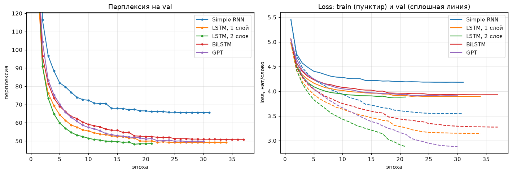
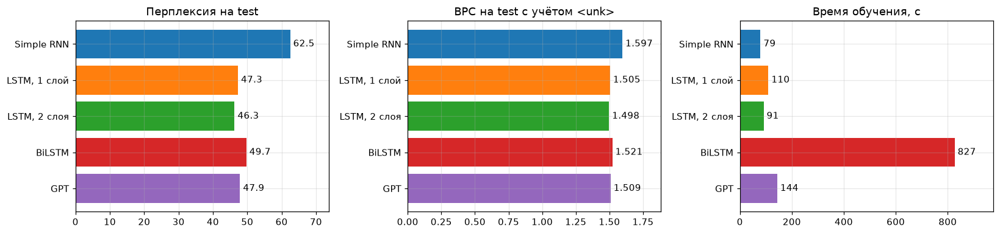
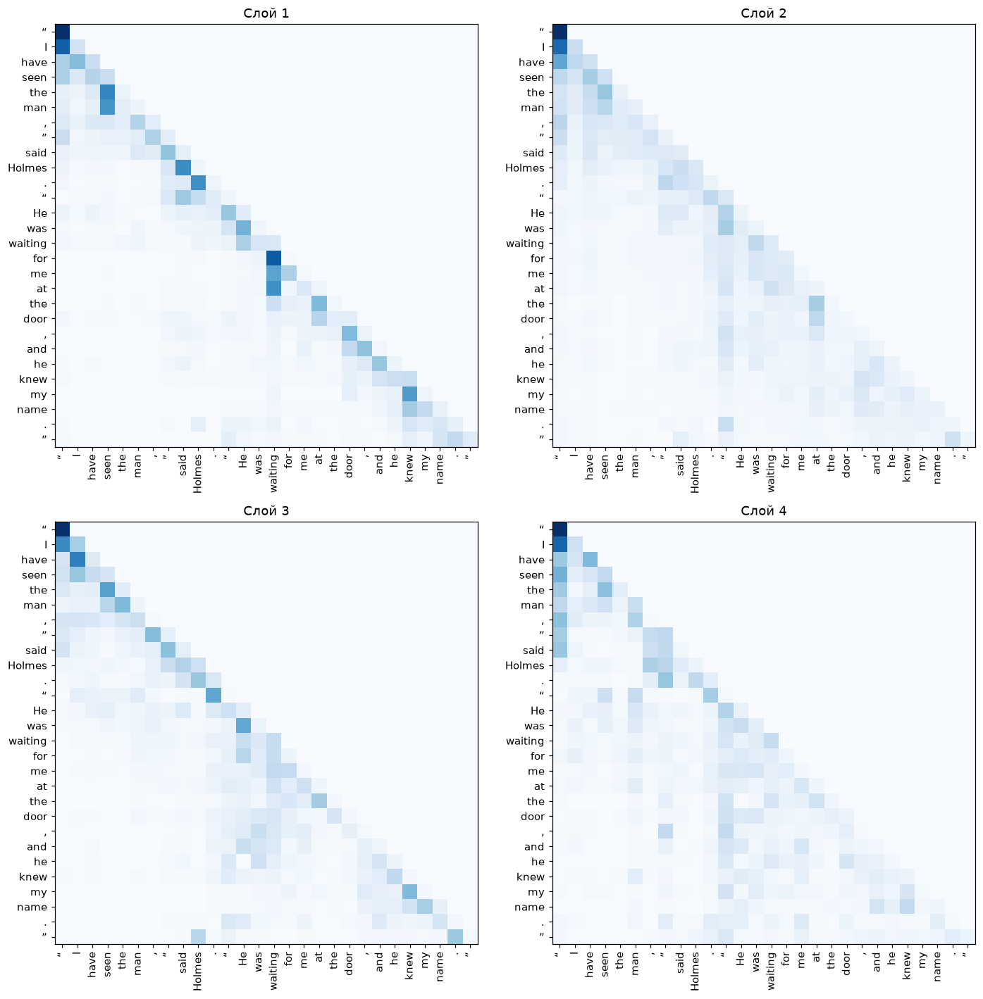

# Генеративные текстовые модели: токенизация по словам

## 1. Задача

Обучить на одном датасете и сравнить генеративные языковые модели:

- Simple RNN;
- однонаправленную LSTM — однослойную и двухслойную;
- двунаправленную LSTM (BiLSTM);
- трансформер-декодер GPT, написанный «с нуля» (по мотивам nanoGPT).

Все модели используют одну и ту же токенизацию по словам. Качество сравниваем по перплексии на отложенном
тесте, по битам на символ (для сравнения с другими токенизациями в команде) и по сгенерированным текстам.

## 2. Датасет

Англоязычная литература с [Project Gutenberg](https://www.gutenberg.org): все 9 книг о Шерлоке Холмсе
А. Конан Дойла — 15 411 абзацев, 3,52 млн символов, 655 тыс. слов.

| Книга | Абзацев | Символов | Слов |
|---|---:|---:|---:|
| A Study in Scarlet | 791 | 236 237 | 43 187 |
| The Sign of the Four | 773 | 229 363 | 42 919 |
| The Adventures of Sherlock Holmes | 2 518 | 555 475 | 104 322 |
| The Memoirs of Sherlock Holmes | 2 178 | 509 539 | 95 349 |
| The Hound of the Baskervilles | 1 470 | 314 110 | 59 040 |
| The Return of Sherlock Holmes | 2 542 | 602 140 | 111 904 |
| The Valley of Fear | 1 504 | 308 454 | 57 497 |
| His Last Bow | 1 416 | 319 994 | 58 884 |
| The Case-Book of Sherlock Holmes | 2 219 | 441 161 | 82 340 |
| **Всего** | **15 411** | **3 516 473** | **655 442** |

**Предобработка.**

- Отрезаны служебный заголовок и лицензия Project Gutenberg, а в «The Case-Book» — реклама издательства в конце.
- Строки внутри абзаца склеены: в исходниках текст разбит переносами по ~70 символов.
- Убраны оглавления, заголовки глав, подписи к иллюстрациям и сноски.
- Типографика приведена к одному виду. В «The Case-Book» прямые кавычки `"` и двойной дефис `--`,
  в остальных книгах «фигурные» кавычки `“ ”` и тире `—`. Без этого одни и те же знаки стали бы разными токенами.
- Убраны `_подчёркивания_`, которыми в Gutenberg размечен курсив.

**Разбиение** сделано внутри каждой книги: первые 90 % текста → train, следующие 5 % → val, последние 5 % → test.
Тест покрывает все книги, а соседние куски текста не попадают одновременно в обучение и в тест.

| | train | val | test |
|---|---:|---:|---:|
| Символов | 3 174 766 | 178 290 | 178 828 |
| Токенов (слова + знаки препинания) | 734 444 | 41 125 | 40 972 |

Файлы `data/train.txt`, `data/val.txt`, `data/test.txt` **общие для всей команды**: на одном и том же тесте
модели с разными токенизациями можно сравнивать между собой (см. раздел 9).

## 3. Токенизация по словам

Токен — это слово или отдельный знак. Правила разбиения (одно регулярное выражение):

- **слово** — последовательность букв; апостроф внутри слова сохраняется (`o’clock`);
- **клитики** отделяются: `Holmes’s` → `Holmes` + `’s`, `don’t` → `don` + `’t`, `I’ll` → `I` + `’ll`.
  Иначе каждая притяжательная форма стала бы отдельным, обычно редким, словом;
- **дефис** — отдельный токен: `to-morrow` → `to` `-` `morrow`. Составные слова почти все редкие, а их части модель знает;
- **числа** и **знаки препинания** (`. , ; ! ? “ ” ‘ ’ — -`) — отдельные токены;
- **конец абзаца** — служебный токен `<p>`;
- **регистр сохраняется**: `The` и `the` — разные токены. Генерация сразу выглядит как обычный текст,
  а токенизация остаётся почти обратимой.

Пример:

```
“Holmes’s cab-horse won’t wait,” said I. It was to-morrow, at 4.30 o’clock—£500 lost.
→ “ Holmes ’s cab - horse won ’t wait , ” said I . It was to - morrow , at <unk> o’clock — £ <unk> lost .
```

Обратное преобразование (детокенизация) расставляет пробелы по правилам: без пробела перед `. , ; : ! ? ” ’`
и клитиками, без пробела после `“ ‘ (`, дефис и тире приклеиваются с обеих сторон. Оно восстанавливает
**98,4 %** абзацев val символ в символ; остальные отличаются мелочами вроде `M.D.` → `M. D.`.

**Словарь** строится только по train; слова, встретившиеся реже `MIN_FREQ` раз, заменяются на `<unk>`:

| MIN_FREQ | Размер словаря | `<unk>` в train | `<unk>` в val | `<unk>` в test |
|---:|---:|---:|---:|---:|
| 1 | 19 998 | 0 % | 1,37 % | 1,67 % |
| 2 | 12 611 | 1,01 % | 2,20 % | 2,46 % |
| **3** | **9 689** | **1,80 %** | **2,94 %** | **3,19 %** |
| 5 | 6 822 | 3,13 % | 4,18 % | 4,26 % |
| 10 | 4 242 | 5,44 % | 6,45 % | 6,27 % |

Выбран `MIN_FREQ = 3`: словарь **9 689** токенов (как в классическом бенчмарке Penn Treebank — 10 тыс.),
`<unk>` занимает около 3 % токенов теста. При `MIN_FREQ = 1` словарь вдвое больше, но больше трети его слов
(7,4 тыс.) встречается в train ровно один раз: по одному примеру осмысленный эмбеддинг не выучить.



Частоты слов подчиняются **закону Ципфа** (частота ∝ 1 / ранг): 50 самых частых токенов покрывают больше половины
текста, 1000 — 85 %, а «хвост» редких слов огромен. Отсюда сильные и слабые стороны пословной токенизации:

| Плюсы | Минусы |
|---|---|
| Короткие последовательности: один токен — в среднем 4,4 символа, поэтому в контекст из 64 токенов помещается ~280 символов текста | Большой словарь: эмбеддинги и выходной слой — 2,5 млн параметров, от 39 до 82 % всех параметров наших моделей |
| Каждый токен — осмысленная единица; модели не нужно учиться складывать слова из букв, все силы идут на связи между словами | `<unk>`: 3,2 % слов теста модель не может ни понять, ни сгенерировать — новые имена и редкие слова ей недоступны |
| Сгенерированный текст всегда состоит из настоящих слов | Формы одного слова (`detect`, `detective`, `detectives`) — независимые токены, общая основа не используется |
| | Softmax по 9,7 тыс. классов — самая дорогая часть вычислений |

## 4. Модели

У всех моделей одинаковые вход и выход:

- эмбеддинги слов размерности 256;
- **выходной слой связан с эмбеддингами** (weight tying): одна и та же матрица `V × 256` превращает слово в вектор
  и вектор — в логиты всех слов. Это экономит 2,5 млн параметров и на небольших данных улучшает перплексию.
  Поэтому скрытое состояние рекуррентных сетей сначала проецируется в 256;
- **dropout** на эмбеддингах и перед выходным слоем — главная защита от переобучения: в train всего 0,73 млн токенов.

| Модель | Устройство | Параметров | из них не эмбеддинги |
|---|---|---:|---:|
| Simple RNN | 1 слой, `h_t = tanh(W·x_t + U·h_{t-1} + b)`, скрытое состояние 512 | 3,02 млн | 0,54 млн |
| LSTM, 1 слой | ячейка LSTM (входной, забывающий и выходной вентили), 512 | 4,20 млн | 1,72 млн |
| LSTM, 2 слоя | две LSTM по 512, dropout между слоями | 6,30 млн | 3,82 млн |
| BiLSTM | 1 слой, 256 в каждую сторону (в сумме 512, как у LSTM), схема many-to-one | 3,67 млн | 1,19 млн |
| GPT | 4 блока трансформера-декодера: маскированное самовнимание (4 головы по 64) + MLP 256→1024→256, pre-LayerNorm, обучаемые позиционные эмбеддинги, контекст 64 | 5,66 млн | 3,18 млн |

**GPT.** Каждая голова считает `softmax(Q·Kᵀ / √d + M) · V`, где маска `M` равна −∞ над диагональю: позиция *t*
не видит следующих слов. Внимание, маска, головы и блоки написаны вручную на `torch.nn` (без `nn.Transformer`).

**BiLSTM.** Двунаправленная сеть на позиции *t* видит слова и слева, и справа, поэтому её нельзя учить как обычную
языковую модель — предсказывать слово *t+1* на каждой позиции: обратный проход уже прочитал ответ (раздел 8).
BiLSTM работает по схеме **many-to-one**: на вход подаётся окно из *L* **предыдущих** слов, сеть читает его
в обе стороны, и по склеенным финальным состояниям прямого и обратного проходов предсказывается одно следующее
слово. Длина окна *L* в каждом батче случайная, от 1 до 64, чтобы модель умела продолжать и короткую затравку.

## 5. Обучение

Условия одинаковые для всех моделей:

- **контекст 64 слова** (~280 символов). GPT больше и не видит (`block_size = 64`), рекуррентные сети учатся на окнах той же длины;
- **4096 целевых слов на шаг оптимизатора**: 64 окна × 64 позиции у однонаправленных моделей и 4096 окон по одному
  целевому слову у BiLSTM. Эпоха — один проход по всем словам train (~180 шагов);
- **AdamW** (weight decay 0,01, у GPT 0,1) с линейным разогревом learning rate на 200 шагов и обрезкой нормы градиента
  до 1 — без неё Simple RNN «взрывается»;
- если после эпохи loss на val не улучшился, **lr уменьшается вдвое**; после 3 таких эпох подряд — **ранняя остановка**
  и возврат к весам лучшей эпохи (максимум 40 эпох);
- **одинаковая оценка**: loss на val/test считается так, что у **каждого** слова контекст — ровно 64 предыдущих слова
  (окно скользит по тексту с шагом 1). Ни одна архитектура не получает больше или меньше контекста, поэтому метрики
  сравнимы. Train loss на графиках посчитан так же и без dropout, поэтому разрыв между train и val — это именно
  переобучение.

**Подбор гиперпараметров.** Размеры моделей фиксированы, а dropout и learning rate подобраны для каждой архитектуры
перебором по perplexity на val — 32 обучения (полная таблица — в ноутбуке и в `results/sweep.csv`):

| Модель | Перебирались lr | Перебирались dropout | Выбрано | Val PPL лучшего варианта |
|---|---|---|---|---:|
| Simple RNN | 1e-3, 2e-3 | 0,2 / 0,35 / 0,5 | lr 1e-3, dropout 0,35 | 65,6 |
| LSTM, 1 слой | 2e-3, 4e-3 | 0,3 / 0,45 / 0,6 / 0,7 | lr 4e-3, dropout 0,6 | 49,2 |
| LSTM, 2 слоя | 2e-3, 4e-3 | 0,3 / 0,45 / 0,6 | lr 4e-3, dropout 0,45 | 48,2 |
| BiLSTM | 2e-3, 4e-3 | 0,3 / 0,45 / 0,6 | lr 4e-3, dropout 0,6 | 50,9 |
| GPT | 5e-4, 1e-3 | 0,1 / 0,2 / 0,3 | lr 5e-4, dropout 0,2 | 49,7 |

Главное наблюдение перебора: на 0,73 млн токенов **все модели упираются в переобучение**, и решает регуляризация.
Даже на лучшей эпохе loss на train у всех моделей на 0,6–1,0 нат ниже, чем на val: например, у GPT перплексия на train
около 18, а на val — около 50. Модели во многом запоминают обучающий текст. Сильный dropout сокращает разрыв
и позволяет учиться дольше: у однослойной LSTM лучшая эпоха смещается с 10-й (dropout 0,3) на 29-ю (dropout 0,6).
Поэтому оптимальный dropout у LSTM — 0,45–0,6, намного выше привычных 0,1–0,2, а при 0,7 модель уже не успевает
сойтись за 40 эпох. У GPT оптимум ниже (0,2): dropout в трансформере стоит в каждом блоке (на внимании,
residual-ветках и MLP), и суммарная регуляризация и так сильная.

## 6. Результаты

Метрики на тесте (последние 5 % каждой книги). Время — чистое время обучения на RTX 3060, без оценки на val.

| Модель | Параметров (без эмбеддингов) | Эпох (лучшая) | Время | Train PPL | Val PPL | **Test PPL** | Test BPC | Test BPC с `<unk>` |
|---|---:|---:|---:|---:|---:|---:|---:|---:|
| Simple RNN | 3,02 млн (0,54) | 31 (28) | 79 с | 34,7 | 65,5 | 62,5 | 1,367 | 1,597 |
| LSTM, 1 слой | 4,20 млн (1,72) | 34 (31) | 110 с | 23,3 | 49,2 | 47,3 | 1,275 | 1,505 |
| **LSTM, 2 слоя** | 6,30 млн (3,82) | 21 (18) | 91 с | 20,5 | **48,2** | **46,3** | **1,268** | **1,498** |
| BiLSTM | 3,67 млн (1,19) | 37 (34) | 827 с | 26,5 | 50,9 | 49,7 | 1,291 | 1,521 |
| GPT | 5,66 млн (3,18) | 30 (27) | 144 с | 18,2 | 49,7 | 47,9 | 1,279 | 1,509 |

- **Перплексия** `PPL = exp(loss)` — из скольких равновероятных слов модель в среднем «выбирает» следующее.
  Между нашими моделями она сравнима напрямую: токенизатор у всех один.
- **BPC** (бит на символ) = `loss / ln 2 × (токенов / символов)` — те же потери на один символ текста.
  По ней можно сравнивать модели с разной токенизацией (раздел 9).
- **BPC с `<unk>`**: пословная модель предсказывает «какое-то редкое слово», но не говорит, какое именно.
  Добавляем стоимость написания неизвестных слов по буквам (символьная биграммная модель по редким словам train):
  1 305 неизвестных слов теста × 31,5 бита в среднем = +0,230 бита на символ, одинаково для всех моделей.





**Что видно из результатов.**

1. **Simple RNN заметно хуже всех** (62,5). Градиент в простой рекуррентной сети затухает за несколько шагов,
   и из 64 слов контекста она реально использует лишь последние. Её кривая на графике останавливается
   заметно выше остальных.
2. **LSTM снижает перплексию на четверть** (62,5 → 47,3): вентили и аддитивное обновление ячейки памяти позволяют
   градиенту проходить через десятки шагов. **Второй слой** даёт ещё ~1 единицу (46,3 — лучший результат),
   но только с подобранной регуляризацией.
3. **GPT — на уровне LSTM, но не лучше** (47,9). Трансформер видит весь контекст напрямую, без затухания, но чтобы
   это преимущество сработало, нужны данные: 0,7 млн токенов — масштаб классического Penn Treebank, где LSTM
   с dropout тоже остаются сильным решением. Зато GPT **сильнее всех переобучается**: на train перплексия 18,
   на val — 50. Эпоха у него в полтора раза дольше, чем у однослойной LSTM (4,8 с против 3,2 с): параметров вне
   эмбеддингов почти вдвое больше.
4. **BiLSTM уступает однонаправленной LSTM** того же суммарного размера скрытого состояния (49,7 против 47,3)
   и учится **в 7,5 раза дольше** (827 с против 110 с): на каждое целевое слово нужен отдельный проход по окну,
   а не одна позиция в общем проходе. Обратный проход по прошлому контексту почти ничего не добавляет: самые важные
   для предсказания последние слова окна он читает первыми, к концу чтения они «затираются».
5. **Регуляризация важнее архитектуры.** Подбор dropout и learning rate менял перплексию LSTM на 6–8 %,
   а вся разница между однослойной LSTM, двухслойной LSTM и GPT — 3,5 %.
6. Перплексия на test у всех моделей немного ниже, чем на val, но порядок моделей одинаковый.

### Что выучило внимание GPT



Карты самовнимания (веса усреднены по 4 головам слоя) для фразы
`“I have seen the man,” said Holmes. “He was waiting for me at the door, and he knew my name.”`
В 1-м и 3-м слоях внимание в основном локальное: около трети веса уходит на **предыдущее слово** (полоса сразу
под диагональю). Во 2-м и 4-м слоях появляются вертикальные полосы под **открывающими кавычками**: слова внутри реплики
смотрят на начало своей реплики в 1,5–3 раза сильнее, чем при равномерном внимании. Модели нужно помнить, что она
«внутри прямой речи», чтобы вовремя закрыть кавычку: рекуррентной сети приходится держать такой признак в скрытом
состоянии, а трансформер просто «оглядывается» на нужную позицию.

## 7. Генерация текста

Генерация авторегрессионная: модель выдаёт распределение следующего слова, слово выбирается, дописывается
к контексту, и шаг повторяется. **Температура** τ делит логиты перед softmax: τ < 1 делает выбор увереннее,
τ > 1 — случайнее, τ → 0 — жадный выбор самого вероятного слова. `<unk>` при генерации запрещён.
Все модели сэмплируют с одним и тем же seed, поэтому там, где их распределения похожи, они выбирают одни
и те же слова: отсюда одинаковые начала некоторых фрагментов (`shutting the matter` при τ = 1.0).

**Влияние температуры** (GPT, затравка `“My dear Watson,” said Holmes,`):

```text
[τ = 0.5] “My dear Watson,” said Holmes, “I have been in the house for some years, and I have no doubt that you are here at present.”
“I have not heard of it yet,” said Holmes, “but I have been too much to blame.”
“You can only be surprised,” said Holmes

[τ = 0.8] “My dear Watson,” said Holmes, “I have been in the house for some years, and I have seldom heard of him.”
“I have now enough to do so,” said Holmes. “There is one little point which I have now left to blame. I hope that it is a statesman, and that I will

[τ = 1.0] “My dear Watson,” said Holmes, shutting his revolver, “you have attached yourself away in a distant jungle.”
“Did you your stepfather see his American master a brave gentleman?”
“Yes: Yes, one positive left.”
“Curious, Watson. I remember how it is. They all agreed that I know
```

**Разные модели** при τ = 0.8, та же затравка:

```text
[Simple RNN]   “My dear Watson,” said Holmes, “I believe you have come. It is a problem which be made.”
               “Did you your report to you now, a brave woman?”
               “They are not, one will do.”

[LSTM, 1 слой] “My dear Watson,” said Holmes, “I will make the truth. It is a problem which are made up my own heart.
               You cannot see a perfectly close case, but I think that there is no very necessary point to lose it.”
               “There is a long way,” said Holmes.

[LSTM, 2 слоя] “My dear Watson,” said Holmes, “I have been in my house for a few minutes, and and I have had some days
               to your conclusion. I now tell a little startling of my evidence which would give me a wire for it.”
               “There is no meaning in the matter, Mr. Holmes,” said I,

[BiLSTM]       “My dear Watson,” said Holmes, “I will make the truth. It is a problem which are made to accept
               the proceedings of the problem which I have now.”
               “You have not not aware of me, Mr. Holmes?” said the inspector.
               “I am very much indebted to you, Watson,” said
```

**Жадная генерация** (τ → 0, затравка `It was late in the evening when`) склонна к зацикливанию:

```text
[LSTM, 1 слой] It was late in the evening when I had been in the house. I had a note of the police, and I had a note
               to my friend, and I had a note to my friend, and I had a note to my
[GPT]          It was late in the evening when I heard the sound of a sharp tap at the door.
               “I am sorry to hear you know, Mr. Holmes,” said Holmes, “but I have no doubt that you have been
```

**Длинный фрагмент** лучшей модели (LSTM, 2 слоя, τ = 0.8):

```text
I had called upon my friend Sherlock Holmes, with the surprise which I had given myself to the previous morning.
“It was a man who knew that I was an excellent man, for I was never denying that I could not serve the place which none
could be known. She had asked me to meet the horses, but I ended by the same instant and left the room, with no one upon
her own night. The idea was that he was most mistaken.”
“You have an excellent cigar, or what I have heard, is the most exact thing of your life and wife?”
“I have always my share of the case, Watson,” said McMurdo, glancing out at the ceiling, “but you have no only courage
for the reason which we have recollection. And this is the truth.”
“Not for the first link.”
“But the security?”
“It was my first question for a warrant. You have hopes of Beecher’s honour, Watson, and that I may be delighted to take
those fresh facts which would indicate my case.”
```

Все модели выучили форму текста: диалоги с кавычками и чередованием реплик, `said Holmes`, обращения `Watson`,
`Mr. Holmes`, имена героев (McMurdo из «The Valley of Fear»). Грамматика держится на коротких отрезках, но смысл
теряется уже через одно-два предложения. При τ = 0.5 текст гладкий, но шаблонный (`I have been in the house…`),
при τ = 1.0 — разнообразный, но с ошибками согласования (`Did you your stepfather see…`).

**Насколько текст «свой».** 40 начал абзацев теста (по 10 токенов) продолжены каждой моделью на 50 токенов
(τ = 0.8) и сравнены с настоящим продолжением Конан Дойла:

| Текст | 4-граммы из train | distinct-2 | Повторы 4-грамм |
|---|---:|---:|---:|
| Конан Дойл (оригинал) | 16,8 % | 83,5 % | 0,1 % |
| Simple RNN | 39,2 % | 64,9 % | 0,7 % |
| LSTM, 1 слой | 38,6 % | 66,3 % | 0,9 % |
| LSTM, 2 слоя | 33,6 % | 69,7 % | 0,5 % |
| BiLSTM | 35,6 % | 68,8 % | 0,6 % |
| GPT | 42,6 % | 68,2 % | 0,6 % |

*4-граммы из train* — доля четвёрок подряд идущих токенов, которые встречаются в обучающем тексте;
*distinct-2* — доля уникальных биграмм (разнообразие); *повторы* — доля 4-грамм, повторяющихся внутри одного
продолжения (зацикливание). Модели заимствуют из train в 2–2,5 раза больше готовых оборотов, чем сам автор,
и заметно менее разнообразны. Больше всех заимствует GPT (42,6 %) — та же картина, что с переобучением в разделе 6;
меньше всех — двухслойная LSTM, у неё же самая низкая перплексия.

## 8. Почему BiLSTM нельзя учить как обычную языковую модель

Двунаправленную LSTM того же размера обучили 3 эпохи «в лоб»: на каждой позиции *t* предсказывать слово *t+1*,
как однонаправленные модели. Обратный проход на позиции *t* уже прочитал слово *t+1*, то есть ответ подаётся
сети на вход:

```
вход:  The   dog     barked   loudly
цель:  dog   barked  loudly   .
       ↑ обратный проход на позиции «The» уже прочитал «loudly», «barked» и «dog»
```

| Модель | PPL в режиме обучения (будущее видно) | Честная PPL на val (будущего нет) |
|---|---:|---:|
| LSTM, 1 слой | 51,4 | 49,2 |
| «наивная» BiLSTM | **1,1** | **191,8** |

Модель «знает ответ» при обучении и бесполезна при генерации, где следующего слова ещё нет:

```text
“My dear Watson,” said Holmes,, with the body in upon a dark were in in discoloured. and I have had than to to your…
It was late in the evening when.
“No, and the window, and the window.
“No, and the window, and the window.
```

Поэтому в основном сравнении BiLSTM работает по схеме many-to-one (раздел 4) и видит только прошлое.

## 9. Сравнение с другими токенизациями (для общего отчёта команды)

Перплексию моделей с разной токенизацией сравнивать нельзя: «слово», «символ» и «BPE-токен» — разные единицы,
и перплексия на символ всегда ниже перплексии на слово. Общая метрика — **BPC (бит на символ) на одном и том же
`data/test.txt`**:

- посимвольная модель: `BPC = loss / ln 2`, если каждый символ (включая `\n`) — отдельный токен;
- BPE: `BPC = loss / ln 2 × (число BPE-токенов теста / число символов теста)`;
- пословная (наша): `BPC = loss / ln 2 × 40 972 / 178 828`, плюс поправка на `<unk>` +0,230.

| Токенизация | Лучшая модель | Test BPC |
|---|---|---:|
| **по словам** (участник 1) | LSTM, 2 слоя | 1,268 (без учёта `<unk>`) / **1,498** (честно) |
| посимвольная (участник 2) | | |
| BPE (участник 3) | | |

Для пословной модели честное число — **1,498**: без поправки она «экономит» биты на неизвестных словах,
которые ей не приходится писать.

## 10. Выводы

1. **Simple RNN — худшая модель** (перплексия на тесте 62,5 против 46–50 у остальных): градиент затухает,
   и длинный контекст ей недоступен.
2. **LSTM решает проблему затухания** и снижает перплексию на четверть; **двухслойная LSTM — лучшая модель**
   (46,3 на тесте, 1,50 бита на символ с учётом `<unk>`).
3. **GPT, написанный с нуля, на уровне LSTM** (47,9). На 0,7 млн токенов трансформеру не хватает данных,
   чтобы обогнать LSTM, и он сильнее всех переобучается. Его головы внимания выучили осмысленные функции:
   связь с соседним словом и отслеживание границ прямой речи.
4. **BiLSTM для генерации годится только в постановке many-to-one** и всё равно уступает однонаправленной LSTM,
   обучаясь в 7,5 раза дольше. «Наивная» BiLSTM подглядывает в ответ: перплексия 1,1 при обучении и 192 при честной проверке.
   Двунаправленность полезна, когда последовательность известна целиком (классификация, разметка, BERT).
5. **На небольших данных регуляризация важнее архитектуры**: подбор dropout менял перплексию LSTM на 6–8 %,
   а разница между LSTM и GPT — 3,5 %. Оптимальный dropout высокий: 0,45–0,6.
6. **Генерация** правдоподобна по форме (диалоги, кавычки, имена, обороты Конан Дойла), но смысл держится
   одно-два предложения. Низкая температура даёт гладкий шаблонный текст, высокая — разнообразный и менее
   грамотный, жадный выбор зацикливается. Модели заимствуют из train в 2–2,5 раза больше 4-грамм, чем сам автор.
7. **Пословная токенизация**: короткие последовательности (4,4 символа на токен) и генерация только из настоящих
   слов — ценой большого словаря (9,7 тыс. токенов, 2,5 млн параметров эмбеддингов) и 3,2 % неизвестных слов,
   которые модель не может ни понять, ни сгенерировать. На их написание пришлось бы потратить ещё 0,23 бита на символ.

## Как воспроизвести

```bash
python -m venv .venv
.venv\Scripts\activate
pip install torch --index-url https://download.pytorch.org/whl/cu128   # PyTorch с CUDA
pip install -r requirements.txt
jupyter notebook WordTokenization.ipynb
```

Ноутбук сам скачивает книги с Gutenberg. Полный прогон на RTX 3060 занимает ~27 минут, из них 14 минут — BiLSTM.
Веса сохраняются в `checkpoints/`; при `RETRAIN = False` повторный запуск загружает их за секунды. Перебор
гиперпараметров (`RUN_SWEEP = True`) занимает ещё около двух часов, его результаты лежат в `results/sweep.csv`.

| Файл | Что в нём |
|---|---|
| `WordTokenization.ipynb` | код, логи обучения, все графики и примеры генерации |
| `data/train.txt`, `val.txt`, `test.txt` | очищенный текст — общий для всей команды |
| `results/metrics.csv` | итоговые метрики моделей |
| `results/sweep.csv` | перебор dropout и learning rate (32 обучения) |
| `results/generation_stats.csv`, `results/samples.json` | статистика и примеры генерации |
| `images/` | графики для отчёта |
